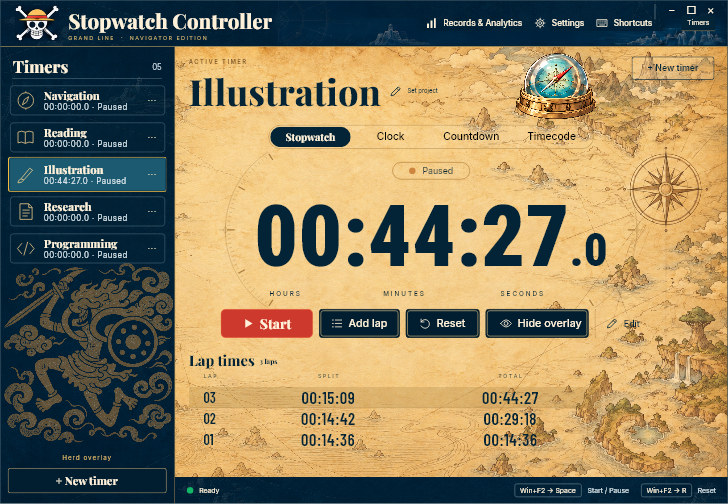
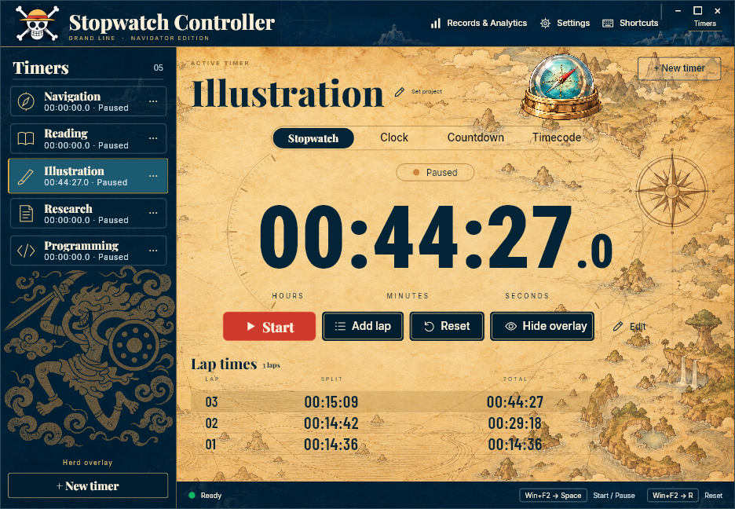
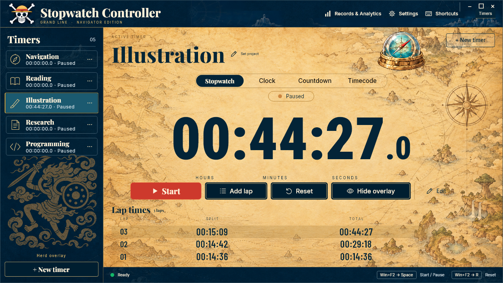

# Controller window sizing correction

Native verification: 2026-11-13. This corrects the window-to-panel mismatch introduced by the Appearance page scaling consumer.

The controller now scales its normal native window along with the panel, uses unscaled client dimensions for the existing layout, and recalculates arrangement after native resizing. Its outer scroll container is removed; the existing internal content scrolling remains. Maximized windows fill their client area. Normal windows are capped to the monitor work area, with native window decorations accounted for where applicable. Floating overlays retain their independent sizing.

The initial implementation reproduced empty outer bands at 70%/90% and overflow at 125%. A further native check caught a stale arrangement when reducing zoom, and launch checks caught sizing from a preliminary client rectangle before the requested window dimensions had been applied. Regression logs retain those failures under `.superpowers/sdd/2026-11-13-controller-sizing/`.

## Native results

| Page scale | Native client size (DIP) | Outcome |
| --- | --- | --- |
| 70% | 728 x 503.33 | Panel fills client area |
| 90% | 936 x 648 | Panel fills client area |
| 125% | 1280 x 720 | Panel fills client area, capped to this monitor |

Measured at 150% Windows display scaling. Edge tolerance is 1 DIP for native pixel rounding; recorded edge errors are below 0.3 DIP at launch. PNGs render the production, arranged controller at its measured client bounds using synthetic timers. They do not crop away blank window margins. The arranged frame is drawn directly to avoid Avalonia's existing nested-Viewbox capture culling issue.

## Verification

- 30 native launch, resize, maximize, restore, live-scale and theme-transition states passed. Tests also check repeated show/apply stability, window controls and timer actions remaining in bounds, and the intended initial zoom dimensions.
- 7 Appearance, 5 Settings shell and 4 retained controller/overlay regression groups passed.
- 1,052 unit tests passed; zero failed/skipped.
- Desktop and native harness build: zero warnings/errors. Unit build retains the existing NU1900 warning because the NuGet vulnerability audit endpoint was unavailable.
- All UI checks ran on private Windows desktops with no desktop switching. Prior source/artwork outside the four changed files was hash-verified unchanged.

Not installed, restarted, committed or pushed. Physical multi-monitor moves and other operating systems were not tested in this correction.
