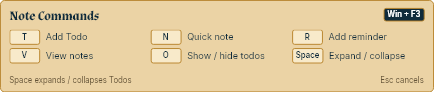
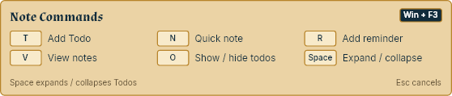
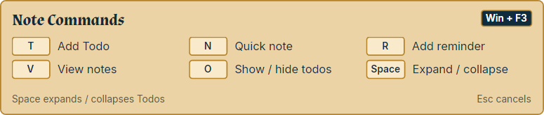

# Note Commands — integrated native popup

Win+F3 now uses the approved compact two-row layout: T Add Todo, N Quick note, R Add reminder; V View notes, O Show/hide todos, Space Expand/collapse. Escape cancels and the existing five-second timeout remains. There is no extra expansion stage.

The controller passes the current settings and note mappings to the popup. Key badges and the leader reflect custom bindings. Unassigned actions are omitted. If Space is mapped to a note action, the fallback Space row and expansion explanation disappear. Existing dispatch and dismissal behavior remain unchanged.

The popup respects application scale and Notes typography. Nika uses the approved parchment palette; other themes retain their colors. Key badges preserve contrast, long key names fit, and content stays within the monitor working area with scrolling available for constrained heights. No new timer, asset or dependency was added.

## Native results

These images render the actual production window. Additional captures cover custom Ctrl+F8, PageDown and Space mappings, unassigned Reminder, 125% text, Midnight and Daylight. All data is synthetic.

## Verification

- New native regression failed against the old text-strip popup before implementation.
- Desktop and fixture builds passed with zero warnings/errors.
- `--shortcuts-only` passed: six-action order, custom Space dispatch, omitted actions, Escape and command dismissal, existing note/Todo controls and timer shortcut regressions.
- `--note-commands-native` passed all three scales and custom/theme cases, checking text/key bounds, footer separation, native frame/window sizing, working-area bounds and captures.
- All runs used `Run-HiddenDesktop.ps1`; no test windows or OS keyboard input reached the user's desktop. Captures visually inspected and `git diff --check` passed.

Logs: `.superpowers/sdd/2026-11-16-note-commands/`. The Linux smoke assertion was updated for the new visual rows, but Linux execution/build was not verified (no restored local assets). The full WPF unit suite was not rerun for this Desktop presentation change.

No install, restart or Git publication. Installed EXE remains A2585F50932B9F2A1322B07D73CD5ABECB5A9282730A45AEC82A4571CFCACC4F. The unrelated logo concepts remain untouched.
