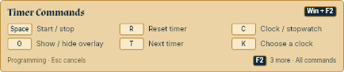
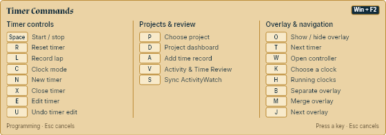
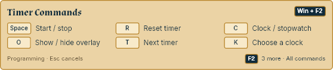
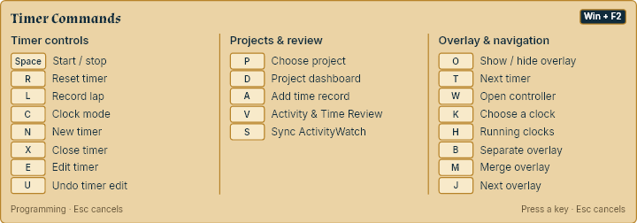
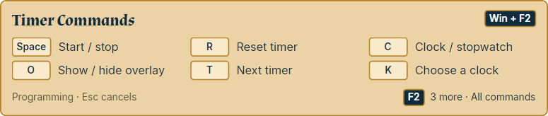
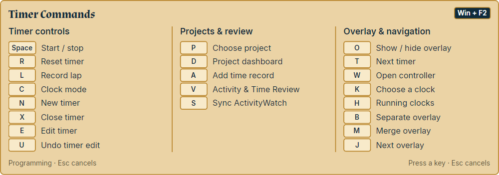

# Timer Commands — implemented native popup

Win+F2 opens the six approved quick actions, in reading order: Space (start/stop), R (reset), C (clock/stopwatch), O (overlay), T (next timer), K (choose a clock). Keys follow the user's mappings; unassigned actions are omitted. E still opens the editor and appears in the full list.

The full list appears on the fourth total press: Win+F2, F2, F2, F2. The first three presses keep the popup compact; its footer counts down “3 more”, “2 more”, “1 more”. Repeating the configured timer leader follows the same count. Further presses retain the full list. If F2 already has a command assignment, it executes that command; the footer advertises the configured leader for expansion instead. Commands omitted from the quick view remain immediately available. Note command mode is unchanged.

The initial timeout remains two seconds, refreshed with each compact-stage press. Expansion gives five seconds to read; executing a chainable command retains the configured chaining timeout. Escape cancels. Switching timers updates the active name in the footer. A fresh command session resets the press count. The full list is constructed only on expansion; there is no additional polling timer or bitmap asset.

Selecting a command immediately hides the popup in compact and full views. Windows shortcut chaining continues without the popup; F2 or the configured leader reopens it and advances the existing press count during the chaining interval. Portal-based local input ends capture with dismissal because follow-up keys require the focused popup.

## Actual native captures

These are rendered from the production `ShortcutCommandHintWindow`, not the earlier prototype. All windows were isolated on a private desktop. Values and project names are synthetic; live settings are never loaded or saved.

| UI scale | Quick view | Full view |
|---|---|---|
| 70% |  |  |
| 90% |  |  |
| 125% |  |  |

Native dimensions: 434×92 / 560×196 at 70%; 558×118 / 720×252 at 90%; 775×164 / 1000×351 at 125%. Measured text and desktop pixel rounding add a few pixels to the original proposal instead of clipping content.

The countdown after presses two and three is shown in `quick-press2-90.png` and `quick-press3-90.png`. Additional captures cover custom Ctrl+F8 / F9 / F10 mappings, an unassigned Reset action, 125% text sizing, a long Persian/English project name, and Midnight/Daylight palettes. `captures.json` records every image's dimensions and SHA-256.

## Verification — 2026-11-16

- Updated regression checks failed against the previous E/two-press implementation before production changes.
- Fresh native/Desktop build: zero warnings or errors.
- `--shortcuts-only`: four deliberate presses, count reset, held-key filtering, C clock/stopwatch toggling, E editor access, immediate dismissal, custom leader/F2 preservation, actual two/five-second timeout expiry, hidden chaining/reopening, note isolation and existing timer actions passed.
- `--timer-commands-native`: all three scales, every countdown step, configured C mapping, custom text/mappings, both legacy palettes, row coverage, window/frame sizing, working-area bounds and captures passed. Captures visually inspected.
- All native checks ran through `Run-HiddenDesktop.ps1`; no desktop switch or OS keyboard injection. `git diff --check` passed.
- The original implementation's full unit suite passed 1,117 tests with no failures or skips and its independent review was clean. These small UI refinements reran the affected native checks; the full unit suite was not rerun.

Latest logs: `.superpowers/sdd/2026-11-16-timer-commands-four-press/` (`red-native.log`, `build.log`, `native.log`, `layout.log`). Original build/unit logs remain in `.superpowers/sdd/2026-11-16-timer-commands/`.

Release artifacts, backup and update/health receipts are kept separately under `.superpowers/sdd/2026-11-16-timer-commands-four-press-install/`; earlier update receipts are retained in their own directories. No Git publication. Windows routing was exercised with synthetic hook events and native controls; physical global input on Linux/macOS was not tested.
